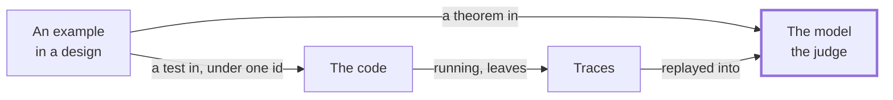

# Figures

When a figure earns its place, how to draw it in Mermaid, and how to keep it true.

- [When to draw](#when-to-draw)
- [Where a figure goes](#where-a-figure-goes)
- [Which diagram](#which-diagram)
- [Drawing conventions](#drawing-conventions)
- [Keeping a figure true](#keeping-a-figure-true)
- [Formats](#formats)
- [A worked figure](#a-worked-figure)

## When to draw

Draw when the subject has a shape the reader would otherwise build in their head:

- **A flow:** the lifecycle, the round trip, a gate's steps.
- **A structure:** what is inside a cell, how the packages relate.
- **Relationships:** the context map, who is upstream of whom.
- **A sequence over time:** a command, a lost answer and a retry.
- **States:** a loan from checkout to return.

Don't draw a definition, a single claim or a list. A figure that restates one sentence costs the reader more than the sentence.

The prose check notes every H2 section of 400 words or more with no figure. Treat the note as a question, not an order. Only you can say whether the section's subject has a shape.

## Where a figure goes

At the head of its section, right after the heading or after one sentence that introduces it. The prose that follows walks through it: "The thick box is the hard gate."

Every figure has a sentence before or after it that says what it shows. The figure never carries a fact the text doesn't, so a reader who can't see it loses nothing.

## Which diagram

| The subject | Mermaid | Direction |
| --- | --- | --- |
| A pipeline or round trip | `flowchart` | `LR` |
| A hierarchy, or steps grouped by who does them | `flowchart` with `subgraph` | `TB` |
| A journey as a DAG | `flowchart` | `LR` |
| Calls and answers over time, retries, the failure window | `sequenceDiagram` | — |
| A cell's or an entity's states | `stateDiagram-v2` | — |

Stay with these three kinds. They render on GitHub, read well in light and dark themes, and diff as text.

## Drawing conventions

- **Twelve nodes at most.** A figure that needs more is two figures.
- **One idea per figure.** If the caption needs "and", consider two.
- **Labels in the page's own terms**, in sentence case. A node is a noun from the page; an edge label is a short verb ("generates", "replayed into").
- **A second line** in a node with ` `, for a few words of detail. The lifecycle diagram does this.
- **One emphasis at most**, for the thing the text points at. Use a thicker stroke, `style X stroke-width:3px`, as the lifecycle does for the hard gate.
- **No fill colors.** GitHub draws Mermaid in the reader's theme, and a fixed fill can vanish in one of them.
- **Quote labels** that hold punctuation: `A["Decide Command → State → Event"]`.

## Keeping a figure true

A figure is a view of the method, and the lifecycle's rule holds for views: generated views own nothing. A hand-drawn figure owns nothing either.

- **Draw only what a page already states.** Every node and edge points at a sentence in this repository or at the example's code.
- **Use the example's real names** when a figure shows the example: its cells, files and journeys.
- **Check a figure of the example against the example's own maps.** A journey figure is checked against `examples/library/JourneyMap.lean` and the journey map golden in `skills/map-the-journeys/references/golden/`. Where the page and the map disagree, draw only what both say, and report the disagreement.
- **A figure of the model matches the model.** If the model changes, the figure changes with it.
- **If you can't draw it faithfully, don't.** Report the section as one that wants a figure, and say what you couldn't settle.

## Formats

1. **Mermaid in the Markdown**, by default. It is text, so it diffs, and the scrub gate reads it.
2. **SVG**, only for what Mermaid can't draw. Keep it in a `figures/` folder beside the page, with the text as real text, not paths. The scrub gate reads SVG as text too.
3. **No PNG or JPEG.** They don't diff, and no gate can read them.

## A worked figure

The README's opening says that every example is a theorem in the model and a test in the code. It says the running code's traces are replayed into the model, which is the judge. That is a round trip, and it has a shape:

The walk-through that follows it would read:

> Every example in a design is a theorem in the model and a test in the code, under one id. The running code leaves traces, and the traces are replayed into the model. The model is the judge.

Each node and each edge is a phrase from those two sentences, and nothing else. The model has the one emphasis, because the text says it is the judge. The rest of the repository says more: the fixtures and feature files the model generates, the tables a design is transcribed from. They stay out of this figure, because this page doesn't say them. A figure drawn for a page holds only what that page states.
