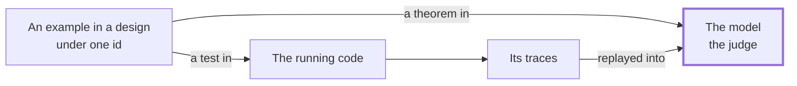

# cell-architecture-calculus

This repository is a strongly typed approach to validating a cell-based architecture, in Lean 4, with functional theorems. It uses the word *cell* in the sense of the [WSO2 cell-based reference architecture](https://github.com/wso2/reference-architecture/blob/master/reference-architecture-cell-based.md). A **cell** is a self-contained unit with its own record and a gateway as the only way in. The calculus says what is inside one:

- an initial state;
- three pure functions, one of which is the fold;
- a terminal predicate.

From that shape the rest follows. Journeys across cells are terms that compile to directed acyclic graphs. Every example in a design is a theorem in the model and a test in the code, under one id. The running code's traces are replayed into the model. The model is the judge.

The figure shows one example's round trip: into the model, into the code, and back to the model through the code's traces.



The repository holds:

- the generic calculus, as one Lean package with no dependencies;
- a worked example that carries the whole round trip;
- the documents that state the method;
- the two scripts that gate a build, and the scrub gate;
- nine skills over the seven steps of the lifecycle an agent leads or prepares, each written and evaluated against the example.

[The case for the method](#the-case-for-the-method), below, points architects and engineers at one paper and technology leaders at the other.

## The case for the method

Two papers at the root of the repository make the argument, for two readers.

| Paper | For whom | What it is |
| --- | --- | --- |
| [White paper](white-paper.md) | Architects and engineers | The hypothesis, the prior art each shape stands on, the calculus shape by shape with its theorems, the method as documents and a round trip, the evidence from the worked example with every number taken from the build, the ten places the method can fail with a proposal for each, the seven problems that had to be decided with what each leaves open, and a call to contribute |
| [Executive summary](executive-summary.md) | Technology leaders | The problem from the leader's seat, what the method changes for an organization, what it removes from the daily work, what it costs, what it does not do, the evidence in one table, and how to start with a one-journey pilot |

## How a claim becomes a theorem

In a formal method like this one, a machine checks every step of every proof. In Lean, that machine is the **kernel**. An argument has five roles, and each has a standard name. If formal methods are new to you, these five are worth knowing before the code below. The table shows each role for a claim small enough to check in your head, 2 + 2 = 4, and where the same role appears in this repository.

| Role | Standard name | In Lean, for 2 + 2 = 4 | In this repository |
| --- | --- | --- | --- |
| The rulebook | The calculus | A version of the Calculus of Inductive Constructions, in Lean's kernel | The same rulebook and kernel, for every theorem in `cell-calculus` and the example |
| The givens | Axioms and definitions | How `Nat` and `+` are defined: `Nat` as zero and successor, `+` by recursion | The shapes of `cell-calculus`, such as the `Cell` structure, and a project's definitions transcribed from its design, such as `circulation` and `loanOut2` |
| The claim | The proposition | `2 + 2 = 4` | `loanOut2.holds circulation = true`, an example from the next section |
| The variable, the thing checked | The proof | `rfl`, checked by computing both sides | `by decide`, checked by computing the example |
| The outcome | The theorem | The claim, once the kernel accepts its proof | `loanOut2_holds` |

In Lean, the claim and its proof fit on one line:

```lean
theorem two_add_two : 2 + 2 = 4 := rfl
```

The claim comes after the colon, and the proof after `:=`. Once the kernel accepts the proof, `two_add_two` is a theorem. Change the claim to `2 + 2 = 5` and Lean rejects it, because the two sides don't compute to the same number.

The rulebook and the givens are fixed before a claim is made. For one claim, the proof is the part that can vary: `rfl` and `by decide` both prove 2 + 2 = 4. The kernel accepts any proof that follows the rules and rejects any that doesn't.

So to trust a theorem, you trust the kernel and the givens, and you read the claim. You don't have to trust whoever wrote the proof. The kernel can't catch a proof of the wrong claim. That is why a person reads the model against its design, which the [four words](#what-it-proves-checks-tests-and-assumes) at the end of this page call *assumed*.

This repository calls its package `cell-calculus` *the calculus*. It is not a second rulebook. It is written under Lean's, so its shapes are givens and its theorems are outcomes.

Two of the four words sort theorems by what they cover:

- `loanOut2_holds` is *checked*. It is a claim about one example's values, and the kernel computes it.
- `replay_append`, in `cell-calculus`, is *proved*. It holds for every cell and every history.

## The calculus changes as the state of the art does

The calculus is not fixed. Each version of it is the method as published practice stood when that version was written. As the state of the art changes, the calculus and the patterns it stands on change with it.

Every shape in the calculus has a published source, such as the Decider, the idempotent receiver, sagas, the outbox and the patterns of a context map. [The calculus](docs/the-calculus.md) and [its foundations](docs/foundations.md) cite them, from 1978 to 2024. Some of that evidence was still open. The foundations record a flaw in Kafka's transaction protocol, KAFKA-17754, as unresolved at publication. Some of the problem is new as well. Agents now write a growing share of the code, from the same documents people read. Practice will move again, and the calculus will move with it.

What doesn't move is a theorem. A theorem holds for the version of the calculus it was proved against, and the build checks every theorem again on every change. What moves from one version to the next is which shapes the calculus carries, which practices it stands on, and which names it uses.

A change arrives by supersession, never by edit. That holds whether a project needed a shape the calculus lacked or practice moved on. The old shape keeps its name, deprecated with its successor and the date, and the version moves. A project requires the calculus at a tag, so it moves to a newer one when it chooses. Each deprecation then names the successor to move to.

The calculus has changed from the start. Version 1 was frozen on Oct 14, 2026. Its first supersession, `ProjectHeader` for `ModelHeader`, came the next day. The first public release, on Oct 19, carried version 2.3.0.

## In twenty lines

A cell decides on commands, reacts to other cells' facts, and folds its own facts into its state. No function returns a command, so one cell cannot quietly trigger another. That wiring cannot be written.

Here is the `Cell` structure in Lean:

```lean
structure Cell (Command ForeignEvent Event State Refusal : Type) where
  initial    : State
  decide     : Command → State → Except Refusal (List Event)   -- Command => State => Event
  react      : ForeignEvent → State → List Event              -- Event => State => Event
  evolve     : State → Event → State                          -- the fold
  isTerminal : State → Bool
```

An example is a row in a design, a value in the model and a test in the code. The kernel evaluates whether it holds.

```lean
/-- A retry after the answer was lost: the same key again, and nothing new is booked. -/
def loanOut2 : Example CirculationCommand CirculationEvent CirculationRefusal :=
  { id := "LOAN-OUT-2 (retry after unknown)", given := [.checkedOut "k1" "b-1" 1],
    when := .checkOut "k1" "b-1", expect := .ok [] }

theorem loanOut2_holds : loanOut2.holds circulation = true := by decide
```

The same example is rendered from that value, and never written by hand, as a JSON fixture and as Gherkin. The implementation's test suite runs the fixture. A reviewer reads the Gherkin:

```gherkin
Scenario: LOAN-OUT-2 (retry after unknown)
  Given copy b-1 was checked out under key k1, 1 on loan
  When a checkout arrives with key k1 for copy b-1
  Then nothing happens
```

## Quick start

Install Lean's version manager once. Each package pins the toolchain, which is fetched on first use. Nothing else is needed. The packages use core Lean only, and the example's implementation and tests use Python's standard library.

```
curl -sSfL https://raw.githubusercontent.com/leanprover/elan/master/elan-init.sh | sh -s -- -y --default-toolchain none
export PATH="$HOME/.elan/bin:$PATH"

cd cell-calculus && lake build && cd ..                        # the calculus: every theorem checked
python3 tools/mutants.py cell-calculus/mutants.json            # its gate: 7 of 7 mutants killed

cd examples/library
lake build && lake exe fixtures                                # the example, and its generated views
python3 ../../tools/review-check.py Library/Governance.lean .  # warns: the design is unreviewed, on purpose
python3 ../../tools/mutants.py mutants.json                    # its gate: 10 of 10
lake exe replay traces/circulation-good.json traces/borrow-run-good.json
python3 -m unittest discover -s impl -v                        # the implementation against the fixtures, by id
```

A wrong claim fails with "Tactic `decide` proved that the proposition ... is false". A journey that loops fails with "fail to show termination". The same steps run in CI.

## Modeling your own system

A team's own package is a `lakefile.toml` that requires the calculus over git at a tag, plus the two types the calculus is generic over. Both are algebraic data types, defined from your corpus:

- The **principal** is who a person or system is when they act.
- The **subject** is what an event is about, bounded by a trust zone where you have one.

From there, each cell is five types and one `Cell` value. The five types are transcribed from the tables of the cell's design: the command, foreign event, event, state and refusal types. The `Cell` value has a branch per row of the Decide table.

The journey map, the context map, the examples, the fixtures, the tests and the traces follow in a fixed order. Every step has a file in the example that does it.

[docs/getting-started.md](docs/getting-started.md) walks the twelve steps, from the corpus's tables to the gates in CI. Each step points at the example's file. This is the short form:

| Step | You write | In the example |
| --- | --- | --- |
| The corpus | The vision with Steps and References tables per journey, the capability map, the architecture with its paths table | [corpus/](examples/library/corpus/) |
| The package | The build file requiring the calculus, the principal and the subject | [Architecture.lean](examples/library/Library/Architecture.lean) |
| The maps | The journeys as DAGs and the context map, with the corpus's claims as theorems | [JourneyMap.lean](examples/library/JourneyMap.lean), [ContextMap.lean](examples/library/ContextMap.lean) |
| The design | Prose, and the tables the model is transcribed from | [designs/circulation.md](examples/library/designs/circulation.md) |
| The cell | The five types, the cell, the examples as theorems, the codec, the mutants | [Circulation.lean](examples/library/Library/Circulation.lean) |
| The views | One line registering the cell. The feature file and the fixtures are generated | [Fixtures.lean](examples/library/Fixtures.lean) |
| The code | A pure fold and decider, and one test per example by id | [impl/](examples/library/impl/) |
| The traces | What the code did, replayed into the model | [Replay.lean](examples/library/Replay.lean), [traces/](examples/library/traces/) |

## The layout

| Directory | What it holds |
| --- | --- |
| [cell-calculus/](cell-calculus/) | The generic package, one module per idea, carrying only universal theorems and nothing of any one project: `Architecture`, `Cell`, `Journey`, `Contract`, `Envelope`, `Inputs`, `Boundaries`, `Policy`, `Promise`, `Wire`, `Coverage`, `Gherkin`, `Render`, `Replay`, `Governance`, `ContextMap`. Every type, constructor, field and definition carries a doc comment, and the missing-docs linter warns when a constructor or field lacks one |
| [examples/library/](examples/library/) | The worked example: a public library's circulation system, with its design corpus, its journey and context maps checked by theorem, one design written to the method's tables, the model, the generated views, a reference implementation tested against them by example id, and its trace replayed into the model |
| [docs/](docs/) | The documents, below |
| [skills/](skills/) | The nine skills, below: one directory each, with the procedure an agent follows, its checklists and templates, the golden answers it is held to, and its evaluations with their fixtures |
| [research/](research/) | The research record that led here: eight dated notes from the earlier trial on a private architecture, with the trial's names replaced, and five literature notes on quality attributes as mathematics. Its [README](research/README.md) says what was changed for publication |
| [future/](future/) | The forward record: the directions being explored now, each stated as a problem before anything is built, with its experiments beside it once there are any. Nothing there changes the calculus or the example until a shape graduates. The first asks [how far below the cell the model can go](future/into-the-code.md) |
| [tools/](tools/) | [mutants.py](tools/mutants.py), the mutation score as a gate; [review-check.py](tools/review-check.py), the review line checked against the design's hash; [scrub-check.py](tools/scrub-check.py), the rule that nothing names a tool, a host, a person or another project's domain |

## The documents

| Document | What it is |
| --- | --- |
| [docs/getting-started.md](docs/getting-started.md) | Modeling your own system in twelve steps, from the corpus's tables to the gates in CI, each step pointing at the file in the example that does it |
| [docs/the-calculus.md](docs/the-calculus.md) | The shapes, each with its theorem, its source and the file it lives in: the three-valued outcome, the cell, the journey algebra, the envelopes, inputs instead of calls, boundaries as types, the one place a fact may become a command, promises as predicates over runs, contracts that fold, governance by supersession, the context map |
| [docs/the-lifecycle.md](docs/the-lifecycle.md) | The method as a lifecycle: nine steps by who leads each, the four places the work is checked against the model, the six-stage round trip with its artifact and acceptance test at each, what a reviewer reads, what the checks catch, and what the method does not do |
| [docs/foundations.md](docs/foundations.md) | The prior art under the calculus: the Decider, the failure window, sagas, the holes in exactly-once, verification-guided development, and the six rules the calculus takes from them |
| [docs/the-dag-rule.md](docs/the-dag-rule.md) | Every journey is a DAG: composition against succession, `Either` as the mechanism, why the cell graph may cycle and a journey may not, and the three checks choreography must satisfy |
| [docs/style-guide.md](docs/style-guide.md) | The standard a model is held to: what goes where, names, comments, proofs, the shapes a model may and may not use, the annotation tables a design and a journey carry, what a reviewer checks, governance |
| [CONTRIBUTING.md](CONTRIBUTING.md) | How changes are made: the calculus by supersession, the example by the style guide, the gates every change passes |

## The skills

The lifecycle has nine steps. At seven of them an agent transcribes, prepares or checks while a person owns the meaning. Nine skills under [skills/](skills/) cover those seven steps. Three of the skills are at step 2.

Each skill is a procedure with its acceptance test at every stage, the rule of what it never does, and the report it ends with. Every skill reads the example as its golden answer, invents nothing a design does not state, and leaves the review line for a person to sign.

Each skill carries `evals/evals.json`: the prompts and assertions it is graded on, with fixtures written for the library. A change to a skill is followed by a run with and without it.

| Skill | What it does | In the lifecycle |
| --- | --- | --- |
| [start-a-project](skills/start-a-project/SKILL.md) | Lays down a package on the calculus from a corpus: the build file at a release tag, the principal and the subject, an unreviewed review line, nothing modeled | Step 1, the package under the corpus |
| [map-the-journeys](skills/map-the-journeys/SKILL.md) | Transcribes the vision's journeys, the capability map and the paths table into a module where each claim is a theorem, and reports a cycle rather than resolving it | Step 2, the journey map |
| [map-the-contexts](skills/map-the-contexts/SKILL.md) | Draws the context map beside it: each cell's context and kind, every arrow's relationship upstream to downstream, coverage as a theorem | Step 2, the context map |
| [annotate-a-design](skills/annotate-a-design/SKILL.md) | Turns a prose design into the tables of style guide section 8, each row traced to its sentence, every gap a question for the owner | Steps 2 and 3, the tables |
| [model-a-cell](skills/model-a-cell/SKILL.md) | Transcribes the tables into a module that builds, covers every kind and passes the gate, one row to one definition | Step 4, the model |
| [review-a-model](skills/review-a-model/SKILL.md) | Prepares the six checks a reviewer makes and what signing would write; never signs on its own | Step 6, the review |
| [test-against-the-model](skills/test-against-the-model/SKILL.md) | Wires a test suite to the generated fixtures, one test per example by id | Step 7, the code |
| [replay-a-trace](skills/replay-a-trace/SKILL.md) | Replays what the code did into the model and reads a rejection as a defect or a learning, never as a trace to edit | Step 8, the traces |
| [change-a-model](skills/change-a-model/SKILL.md) | Carries a changed design into the model by supersession: retired, deprecated, aliased, versioned, never deleted | Step 9, the change |

## What it proves, checks, tests and assumes

Four words are used in those places and no others:

- **Proved**: a universal theorem, true for every cell, every history, every command, checked by the Lean kernel.
- **Checked**: a decidable claim about one project's values, such as "this journey has no loops" or "this example holds", computed by the kernel.
- **Tested**: the code against the model, through the generated fixtures and the replayed traces.
- **Assumed**: the world outside the model, and whether the model means what the design's prose intended, which is a person's review, recorded where the build can see it.

## License

Apache 2.0. See [LICENSE](LICENSE).
