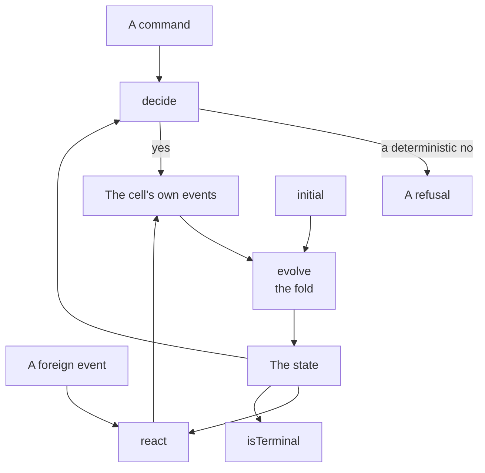
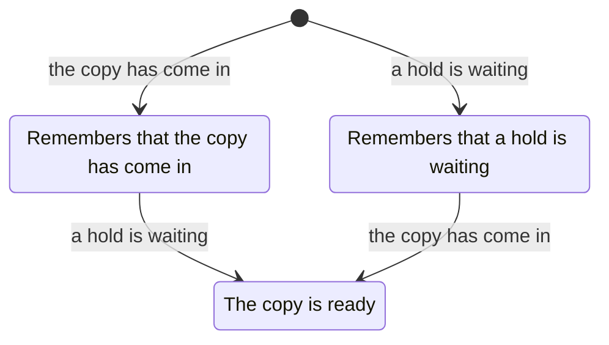

# The calculus

This page covers the shapes of the method, each with its theorem, its source and the file it lives in. Where an entry names the file its shape lives in, the file comes first. It describes the calculus at version 2.3.0, the version in `cell-calculus/lakefile.toml`. The calculus changes as published practice does, as [the README](../README.md#the-calculus-changes-as-the-state-of-the-art-does) says.

The generic shapes are the package [`cell-calculus`](../cell-calculus/). It has one module per idea and carries only universal theorems. It is generic over a project's principal through one class, and over the subject an event is about as a type parameter. Trust boundaries are an opt-in module.

One project's instantiation is the package [`Library`](../examples/library/), in the worked example. Every claim below is shown on it.

The shapes are stated in Lean, because the statement is also the check. Type parameters with a role are words, and a genuinely arbitrary one is a Greek letter. Every declaration other than a theorem carries a comment. The comment says what the declaration is and what the shape is called in the sources.

## Terms

The page defines these terms, each in the entry linked beside it.

| Term | What it is | Entry |
| --- | --- | --- |
| **Cell** | A self-contained unit of components, with its own record and a gateway as the only way in | [The cell](#the-cell) |
| **Refused** | The cell's invariants saying no, deterministic and final | [Outcomes have three values](#outcomes-have-three-values) |
| **Unknown** | The failure window: the effect may or may not have landed | [Outcomes have three values](#outcomes-have-three-values) |
| **Succession** | A journey's last fact as the trigger of a new run of another. The relation may cycle | [Composition must be acyclic, and succession may cycle](#composition-must-be-acyclic-and-succession-may-cycle) |
| **Contract** | A step's non-functional contract: one assumption and a guarantee per viewpoint | [Contracts fold along a journey](#contracts-fold-along-a-journey) |
| **Mutant** | One deliberate change to the model, which the examples, traces and theorems must notice | [Coverage has a second half](#coverage-has-a-second-half-and-it-is-mutation) |
| **Envelope** | One of the two types, defined once, that wrap every command and every event | [Two envelopes](#two-envelopes-wrap-every-command-and-every-event) |
| **Actor** | A sum over the five kinds of sender the calculus names | [Two envelopes](#two-envelopes-wrap-every-command-and-every-event) |
| **Scrub** | A parse from one boundary's event to another's | [Boundaries as types](#boundaries-as-types) |
| **Policy cell** | A cell whose `decide` is the one place a proposal becomes a downstream command | [A fact may become a command](#a-fact-may-become-a-command-in-exactly-one-place) |
| **Promise** | A predicate over runs | [Promises](#promises-and-what-an-attribute-quantifies-over) |

## The problem the calculus answers

Software documentation has three defects it can't cure on its own:

- Nothing shows that every reader understands it the same way.
- Nothing shows that it is accurate.
- Nothing shows that the code built from it went where it pointed.

The documents make claims about structure: which capabilities exist, which journeys use them, and which zones may talk to which. Those claims are kept by hand in several places that drift. Once the code exists, nothing but a person's memory says whether it went where the documents pointed.

The calculus is the answer in four steps, each feeding the next:

1. Design on practices with proved theory under them.
2. State the design's structural and behavioral claims as a model in Lean. There, what is decidable is decided by computation, and what is universal is proved.
3. Derive the specification by example from the model, so that each example is one row in the design, one theorem in the model and one test in the code.
4. Carry the examples' results against the implementation, and the implementation's traces, back to the model as the judge.

One rule makes the four steps one lifecycle: the domain types and the examples are authored once, in Lean, and everything else is generated from them or replayed into them.

Prose owns meaning. Lean owns structure and behavior. Generated views own nothing.

## The cell

The word *cell* is the cell-based reference architecture's. A **cell** is a self-contained unit of components. It keeps its own record, and its gateway is the only way in. It can be deployed and observed on its own. It talks to other cells through its gateway and through the facts it publishes.

The calculus takes that unit and says what is inside it.

### Outcomes have three values

**File:** `Cell.lean`

The `Exception` type has two constructors, `refused` with its reason and `unknown`:

```lean
inductive Exception (Reason : Type)
  | refused (reason : Reason)
  | unknown
```

Every gateway returns `Either[Ex, B]`, and `Ex` is itself a sum, `Either[Refused, Unknown]`.

- **Refused** is the cell's invariants saying no. It is deterministic and final, and the journey stops at a named outcome.
- **Unknown** is the failure window. The effect may or may not have landed.

The two sides come from different places, and the types say so. A cell's `decide` returns `Except Refusal (List Event)`, which is the inner `Either[Refused, B]`, so a cell can say yes or a deterministic no, and nothing else.

The third value is added only where a result crosses the wire. `liftToWire` maps a cell's result into `Except (Exception Refusal) B`. It turns a refusal into `refused` and never produces `unknown`; that is the theorem `model_never_unknown`. Only the world produces *unknown*. The model's job is to say what the caller may do about it: retry with the same key, and never decide as if the effect didn't happen.

Mixing the two up is the specific bug the failure window produces. A timeout gets treated as a refusal, and an effect that did land is compensated away.

### A cell is an initial state, three pure functions, one of which is the fold, and a terminal predicate

**File:** `Cell.lean`

The `Cell` structure holds the initial state, the three functions and the terminal predicate:

```lean
structure Cell (Command ForeignEvent Event State Refusal : Type) where
  initial    : State
  decide     : Command → State → Except Refusal (List Event)   -- Command => State => Event
  react      : ForeignEvent → State → List Event              -- Event => State => Event
  evolve     : State → Event → State                          -- the fold
  isTerminal : State → Bool
```

The figure draws the same structure as a flow. A command and a foreign event go in. The cell's own events pass through `evolve`, the fold, into the state, and no arrow ends at a command.



The parameters are the cell's commands, the foreign events it subscribes to, its own events, its state and its refusal reasons.

The `Cell` structure is the Decider of functional event sourcing with a reaction added and the command sink removed. No function returns a command. `Event => Command` is not forbidden by a rule. It is unrepresentable, and an attempt to write it is rejected at the type.

State is the fold of the cell's own events and nothing else: `replay history = history.foldl evolve initial`. Determinism is not a property to test. The functions are pure by construction.

`replay_append` says that replaying `h ++ h'` equals replaying `h` and then folding `h'`. It holds for every cell and every history, and it is what makes a snapshot sound.

In the example:

- `circulation` decides checkouts, returns, renewals and the close on the loans a card holds;
- `notices` reacts to circulation's facts and commands nothing;
- `pickup` reacts to two cells' facts and remembers whichever came first.

The idempotent receiver is a theorem about the cell, not a test of one case. `checkOut_idempotent` says that for every key, item and open-card state in which the key was already honored, a repeated checkout produces no event.

### Six rules the calculus takes from the foundations

Each rule has its source in [foundations.md](foundations.md).

1. Every gateway is an idempotent receiver. A command carries a key its caller minted before the first remote call and persisted with the caller's intent.
2. A command's outcome has three values, not two. `unknown` is the window made visible.
3. A saga records its intent before its first remote effect and its result after its last. It is resumable from the intent between the two.
4. Events are published from the same record as the state, never from memory. This is the outbox.
5. Queries create no obligation and carry no window.
6. Non-determinism lives at the roots. People, time and any automated judgment are sources of facts. A judgment is an event carried in a published schema. Everything downstream is a pure reaction, testable with the judgment as a Given. This is the rule that lets a language model, or any heuristic, sit inside a deterministic architecture.

## Journeys

### A journey is a DAG by construction, two ways

**Files:** `Journey.lean`, and `JourneyMap.lean` in the example

A journey transcribed from the vision's Steps table is a list of steps. Each step names the earlier steps it waits on, and `wellFormed` checks that every edge points backwards.

A journey written as code is a `do` block in `Except` whose steps are the cells' `handle` and `handleForeign`. Lean accepts only total functions, so a journey that re-entered an earlier step would need recursion it cannot prove terminating. Such a journey is rejected with "fail to show termination".

### A journey is a term, and every term compiles to a DAG

The two ways meet in an algebra with three constructors and no loop:

```lean
inductive Journey (State Refusal : Type)
  | step (name : String) (run : State → Except Refusal State)
  | seq  (first second : Journey State Refusal)
  | par  (left right : Journey State Refusal) (merge : State → State → State)
```

`run` is its denotation, one function. `run_seq` and `run_par` say the composite is the composition, by definition.

`compile` numbers a term's steps and records what each waits on. The theorem `compile_wellFormed`, by structural induction over the three constructors, says every term's compiled graph satisfies the same `nodesOk` rule the transcribed journeys are held to. So a journey from the vision document and a journey composed in the algebra are checked by one rule.

The borrow journey of the example is such a term: circulation deciding, then notices reacting. `borrowJourneyTerm_warns` pins its outcome, the checkout and the warning, beside `borrowJourney_warns` for the hand-written `do` block it supersedes.

### A journey is a cell

The composite of a `decide` and a `react` has the decider's signature:

- a root command in;
- the product of histories as state;
- a refusal or events out.

Composition is closed, so journeys compose into journeys under the same rules, and the whole system is one cell.

There are two consequences:

1. **The composite's state is a product and never a merge**, so a cell seeing only its own state is visible in the type of every journey.
2. **Function composition is associative**, so where the cut between cells falls is a parenthesization, and the composite is the same under every choice. A boundary can move without the behavior changing.

### Choreography realizes composition

In the composite, fan-in is a function of two arguments, and time is gone. In the world, the two facts arrive one at a time, in either order. The reacting cell must remember the first while waiting for the second.

The composite is the denotation, and the choreography is the operational reading. The theorem with content is that they agree.

The example's hold shelf readies a copy when it has come in and a hold is waiting. The figure draws its two orders: the first fact is remembered, and the copy is ready only after the second.



`deliver_returnFirst` and `deliver_holdFirst` say that delivering the two facts one at a time, in either order, readies the copy exactly as the two-argument function does, for every copy. `deliver_oneFact_notReady` says nothing is ready after one fact alone.

### Composition must be acyclic, and succession may cycle

A journey may run another as a step. That is composition, and that relation must be acyclic.

A journey's last fact may be the trigger of a new run of another. That is **succession**, and that relation may cycle, because each edge is a new fact and a new run.

The everyday loop of a product is a succession of DAG runs, never one cyclic journey.

The example's `composition_isAcyclic` and `succession_cycles` are the two theorems. `referencesWithoutKinds_cycle` shows what the map would find if the two were mixed. The full argument is in [the-dag-rule.md](the-dag-rule.md).

### Contracts fold along a journey

**File:** `Contract.lean`

A step's non-functional **contract** is one assumption and a guarantee per viewpoint. The guarantees fold along the journey algebra, with a rule per viewpoint:

- **Latency** is the sum along a sequence and the max across a fan-out, which is the critical path of the compiled DAG.
- **Unavailability budgets and cost** add along both constructors, because a `par` is all-must-succeed, and so is series for everything but time.
- **Peak resource** is the dual of latency.

`elapsed_le_latencyBound` is the compositional theorem. If every step honored its own bound, the journey's run is within the folded bound, for every journey, every set of contracts and every run.

The three monotonicity theorems are the refinement direction: a cell may tighten a guarantee, and no journey's bound gets worse.

The sources are Benveniste and others on contracts for system design, and network calculus for concatenation as a sum.

## The wire, and the examples

### The wire is a projection, and the parse is in the model

**File:** `Wire.lean`

Proto, JSON Schema and Avro cannot say what the model's sum types say: no invariants, loose fields. So the wire shape is a projection of the model's type. What the projection loses is a list per schema, and every item on it is one thing, a refusal at parse time.

A command type's codec is a class, `WireCodec`, whose third field is the round-trip law, so an instance cannot exist without the proof that every command survives the wire.

The gateway, parse then decide, is generic over the class. Its refusal type is the sum of the two kinds. `gateway_serialize` says that for every cell, history and command, the gateway on a serialized command is the cell's own decision.

The same pair serializes every example into a fixture and parses every trace back, so the model and the tests share bytes rather than a description of the data.

Three more classes make the rest generic:

- `JsonEncode` renders a value as JSON for the fixtures.
- `Kinded` numbers a sum type's constructors, so the coverage checks are one definition for every project.
- `Describe` gives each constructor a sentence, so the Gherkin renderer is one definition for every project too.

### Specification by example is a type

**File:** `Cell.lean`

An `Example` carries an id, a Given, a When and an Expect:

```lean
structure Example (Command Event Refusal : Type) where
  id     : String
  given  : List Event
  when   : Command
  expect : Except Refusal (List Event)
```

`Example.holds cell ex` is a Boolean the kernel evaluates. The `id` is the row in the design document and the name of the test in the code.

A `ReactionExample` is the same, with a foreign fact as its When and the facts the cell emits as its Expect, since a reaction cannot be refused.

An example set is a Lean value, and the coverage theorems hold over it: every command kind, every event kind and every refusal reason appears in some example, or the file does not compile.

A trace is a list of command and outcome steps the implementation reported. It is replayed by `Cell.conforms`, which says whether the model allows it. For a trace the model rejects, `Cell.firstRejection` names the step.

The Gherkin rendering of each example is a fold over the same value, for the reader who reviews sentences.

In the example, `circulationExamples_coverCommands`, `_coverEvents` and `_coverRefusals` are the three coverage theorems. `goodTrace_conforms` and `badTrace_rejected` are conformance on a correct run and on one that booked a retry twice.

### Coverage has a second half, and it is mutation

**File:** `tools/mutants.py`

The coverage theorems say every kind is reached. They do not say every branch is pinned.

A **mutant** is one deliberate change to the model, and the examples, traces and theorems must notice. A mutant that builds has found a part of the model nothing pins, and that is a failing test.

The example's 10 mutants include:

- the limit off by one;
- the warning at the level rather than over it;
- the fine's comparison backwards.

The first two are each killed by a named example that sits on the boundary, `LOAN-OUT-4` and `NOTICE-WARN-3`. The third is killed by `FINE-ASSESS-1`, three days late, because on the due day itself the two comparisons agree.

The source is coverage for formal verification as Chockler, Kupferman and Vardi define it, repeating the verification on mutants of the model.

## The envelopes, inputs, boundaries

### Two envelopes wrap every command and every event

**File:** `Envelope.lean`

Nothing so far said what a command or an event carries besides its payload. Two **envelopes**, defined once, wrap every command and every event:

```lean
structure CommandEnvelope (Payload : Type) where
  actor       : Actor              -- what identity answered, never looked up in decide
  key         : IdempotencyKey     -- minted by a device or partner; derived from the cause inside
  causation   : Option EventId     -- the one fact this command succeeds
  correlation : RunId              -- the journey run
  issuedAt    : Instant
  payload     : Payload

structure EventEnvelope (Payload Subject : Type) where
  id          : EventId
  causation   : CausationId        -- a command key or an event id: the DAG edge
  correlation : RunId
  version     : SchemaVersion
  subject     : Subject            -- what the event is about; a bounded ID where the project has zones
  recordedAt  : Instant
  payload     : Payload
```

There are no property-bag headers. A cell reads only the fields the type names, and a decider that reaches for a header the envelope lacks is rejected at the type. The fold never sees an envelope. The shell wraps what a decider emits.

**`Actor`** is a sum over the five kinds of sender the calculus names:

- a principal in the project's own terms;
- a policy cell;
- the timer;
- a partner;
- the operator.

So a decider's actor branch is a `match` the kernel checks is total. A project that needs a sixth kind proposes it to the calculus.

`Cell.gated` lifts any cell to the envelope with a policy saying which actor may issue which command. Each of these is a theorem for every cell and policy:

- a refused actor gets no further;
- an allowed actor gets exactly the inner decision;
- the fold is untouched.

A policy written as permits and forbids carries Cedar's trio as theorems: a forbid overrides every permit, a permit is required, an empty set of permits denies everything, and the rules are a set, so their order and duplicates do not matter.

A derived key names its issuer and its cause, so a retry derives the same key without remembering anything.

With causation and correlation on every event, a run's shape is checkable without replaying it. The events become nodes needing the event they cite. `Run.conforms` is `nodesOk` again, the rule the compiled journeys are held to. `envelope_conforms` says that what the shell publishes on any command, for any cell, subject, clock reading and minting function, is a run that conforms.

In the example:

- a guest's checkout is refused before circulation is consulted, `loanActor1_holds`;
- a run in which the warning was recorded before the checkout it cites is rejected on shape alone, `backwardsRun_rejected`.

### Inputs, never calls

**File:** `Inputs.lean`

`decide` is pure, and a decider may need another cell's answer or the date. The shell gathers every query answer and the clock reading before it calls `decide`. It hands them over as one argument beside the command. A decider that reaches for the clock is rejected at the type, because `decide` returns `Except` and not `IO`.

A query is a pure read of the owning cell's state. Its answer is stamped with the owner's version, so a decision made on it records what it was made on, and the owner refuses the resulting command if it has moved on since.

This is Command Query Responsibility Segregation, with its eventual consistency made a field rather than a caveat. Rule 5 of [foundations.md](foundations.md) has the lineage.

The clock is a cell whose events are ticks, and `tick_monotone` says its history never runs backwards. A command that declares no query reads none, for every envelope, every pair of answers and every pair of readings. Examples gain a *with* clause, and traces record the inputs, so a replay is exact.

In the example, fines assesses a late item on circulation's stamped answer and the day it is. `stillOut_fresh`, `stillOut_staleAfterCheckIn` and `assess_recordsCirculationsVersion` are the three halves, and `settle_readsNothing` is the no-reads theorem.

### Boundaries as types

**File:** `Boundaries.lean`, opt-in

An identifier that must not cross a trust boundary is indexed by the boundary that knows it, so the kernel refuses a record in one boundary built with another boundary's ID.

The alias map carries its inverse law as a field, so a map that does not invert cannot be constructed.

The **scrub** is a parse from one boundary's event to another's. It is owned by one cell, and it is the one function in the system whose type names two boundaries.

- `scrub_keepsEnvelope` says the run is one run on both sides.
- `scrub_roundTrip` says that what the scrub lets through, re-identification returns exactly, for every map, tokenizer and event.

In the example, the desk knows a member by card and the stacks by patron token. The map between them has its inverse proved, and `deskFact_scrubs` carries a checkout fact across with its envelope kept.

## A fact may become a command in exactly one place

**File:** `Policy.lean`

The one place is a journey boundary, as succession. A journey ends with a fact. The fabric lifts the fact into a command to the one cell that subscribes to it as a root, mechanically. The command carries the key derived from the fact, the fact as the cause and a fresh run, so that a retry of the lift is the same command, `succeed_sameKey`.

That cell is a **policy cell**, whose `decide` is the one place a proposal becomes a downstream command. Every branch of a policy cell names its rung. In shadow, a proposal is recorded and never issues. In review, it is held until a person approves it, and an approval issues only what was held. Each of those is a theorem for every proposal and state. In autonomous, it issues, checked on the example's proposal.

The calculus models every automation as this one shape, whether a recommender, a scheduler or an agent. The gated policy cell refuses an approval from the wrong actor before it looks at the ladder.

In the example, the reading assistant's renewal proposal runs through the three rungs. A member's approval issues it, and a guest's is refused at the gate.

## Promises, and what an attribute quantifies over

**File:** `Promise.lean`

With `issuedAt`, `recordedAt`, `causation` and `correlation` on every event, a **promise** is a predicate over runs: within a duration, at most a count, never after a fence. It is evaluated in the same pass that checks a run's shape.

The runs that fail are named. A measure sits beside the promise: the count kept over the count seen. `withinDuration_mono` says loosening a limit never breaks a kept promise, which is why a promise can be tightened in steps.

A quality attribute is checkable only once it says what it ranges over, so the `Attribute` type fixes that in its constructor. An attribute ranges over one of:

- one run, which is a promise;
- a pair of runs, the shape of a confidentiality claim no single run can refute;
- a population, a promise with a threshold, which is a hyperproperty over the window;
- a distribution, which no finite set of traces checks and which the attribute says is measured;
- the artifact, a decided proposition about the model itself.

`population_kept_of_all` says a promise every run keeps is kept at any threshold.

The example's "a limit warning within a minute of the checkout that reached it" is one line, a population promise at 99 percent. A run whose warning came five minutes late burns it by name.

## Governance of the model

**File:** `Governance.lean`

Governance is the changelog rule applied to the model.

- **A theorem is never deleted.** It is superseded by name with Lean's `deprecated` attribute, so a use of the old one warns and names its successor.
- **A statement that a change to the model makes false is not a theorem.** The build rejects it, and it is removed, while the example it proved is retired with its successor.
- **An example is never deleted.** It is marked superseded with the date and the reason. The coverage theorems run over the live set, so that retiring an example without a successor fails coverage, and the failure names the command kind, `hole_isNamed`.
- **An event version is never removed.** The upcaster from every version ever published is total by exhaustiveness, which is the check Lean already does.

The project's header carries one review line per design: the design's path and its content hash at review. The build checks it: a warning while unreviewed, and a failure when the design changes under a signed line.

## The context map

**File:** `ContextMap.lean`

The journey map says which cells exist, where each lives and which arrows join them. The context map says what each arrow means to the two sides, in the vocabulary Evans and Vernon named:

- who is upstream and who is downstream;
- an open host service, a published language or a plain supplier upstream;
- a customer, a conformist or an anti-corruption layer downstream;
- partnership, shared kernel or separate ways, where the design says so.

The one computation is coverage: every arrow between two contexts is accounted for by a relationship in the right direction, `allCovered`. Adding a relationship never uncovers an arrow, `covered_mono`.

What the relationship means in this method:

- A conformist's parse is the identity up to shape.
- An anti-corruption layer's parse is a real translation. It is the only place a refusal means "not understood" rather than "no".

In the example:

- notices translates because it puts the name back;
- every outside party is translated at the edge;
- no core context conforms to a generic one.

## What it proves, checks, tests and assumes

Four words are used in these places and no others:

- **Proved**: a universal theorem in the calculus or about a project's cells, true for every input, by `simp`, `cases` or induction.
- **Checked**: a decidable claim about one project's values, by `decide` or `rfl`.
- **Tested**: the code against the model, through the fixtures and the traces.
- **Assumed**: the world, every judgment a person or an automation makes, and whether the model means what the design intended.

## Limits

Each limit is a place the method can fail, and what it does about it.

1. **The specification gap.** Lean proves the model, never that the model means what the prose intended. Four claims stand in for "the examples have the model's geometry", each with a different proof:

   | Claim | What it says | Its proof |
   | --- | --- | --- |
   | Consistency | Every example agrees with the model | A theorem |
   | Coverage | The examples reach every part of the model | The structural half is a theorem over the example set. The behavioral half is mutation |
   | Conformance | The implementation's behavior is one the model allows | The trace is replayed |
   | Provenance | These tests ran against this model, and this model was reviewed against this design | The stamp on every view and the review line in the header |

   What is not proved is refinement: that *every* implementation behavior is a model behavior. Mutation scores are evidence. The review is a review.
2. **Examples are not coverage.** Thirteen examples prove thirteen points. The next layer is random inputs drawn from the types, with the compiled model as the oracle, the pattern Amazon used for Cedar. Random inputs that kill a mutant become examples. It is not built.
3. **The model-to-code link is testing, not proof.** In rising strength:
   1. traces and tests for every cell, with the claim written as "agrees with the model on every input tried";
   2. the model as the code for a pure core, since `decide`, `react` and `evolve` have no I/O and Lean compiles to C;
   3. refinement proofs last, and only where the second is impossible.
4. **Judgments are never proved.** A judgment is a root fact. The boundary is a type, and the schema's parser is the oracle. The theorems state what a judgment cannot do: a reaction to it emits events and never commands. Its quality is measured and reported beside the theorems, never mixed with them.
5. **The window is a value, not a model.** `unknown` is in the type and a rule in a comment. The next piece of theory is:
   - the saga as a cell with intent recorded, remote answered and result recorded;
   - the theorem that "intent, unknown, retry with the same key, ok" equals "intent, ok" for any idempotent receiver.
6. **Event sourcing is a commitment.** Each cell keeps its history as one of:
   - an event store where `replay` is literal;
   - versioned rows where a row version is an event and the current row is the snapshot that `replay_append` makes sound.

   A cell that keeps neither is one the calculus does not describe.
7. **Modeling what is easy to model.** A method that proves structure and skips behavior proves the cheap thing. The annotation grammar makes behavior mandatory: a design's model must contain a `decide` for every command in its Commands table and a `react` for every foreign event in its Subscribes table. The coverage theorems must also hold. A design with tables and no decisions fails the same check as one with no examples.

## Sources

- Adzic, Gojko. *Specification by Example.* Manning, 2011.
- Benveniste, Albert, and others. *Contracts for System Design.* Foundations and Trends in EDA, 2018.
- Bernhardt, Gary. "Functional Core, Imperative Shell." 2012.
- Chassaing, Jérémie. "Functional Event Sourcing Decider." 2021. https://thinkbeforecoding.com/post/2021/12/17/functional-event-sourcing-decider
- Chockler, Hana, Orna Kupferman, and Moshe Vardi. "Coverage Metrics for Formal Verification." CHARME, 2003.
- Cirstea, Horatiu, Markus Kuppe, Benjamin Loillier, and Stephan Merz. "Validating Traces of Distributed Programs Against TLA+ Specifications." SEFM, 2024. https://arxiv.org/abs/2404.16075
- Cutler, Joseph W., and others. "Cedar: A New Language for Expressive, Fast, Safe, and Analyzable Authorization." OOPSLA, 2024. https://arxiv.org/abs/2403.04651
- Dean, Jeffrey, and Luiz André Barroso. "The Tail at Scale." Communications of the ACM, 2013.
- Disselkoen, Craig, and others. "How We Built Cedar: A Verification-Guided Approach." FSE Industry, 2024. https://arxiv.org/abs/2407.01688
- Dymitruk, Adam. "Event Modeling." https://eventmodeling.org/
- Evans, Eric. *Domain-Driven Design.* Addison-Wesley, 2003.
- Garcia-Molina, Hector, and Kenneth Salem. "Sagas." SIGMOD, 1987.
- Helland, Pat. "Data on the Outside versus Data on the Inside." CIDR, 2005. "Life beyond Distributed Transactions." CIDR, 2007. "Idempotence Is Not a Medical Condition." ACM Queue, 2012.
- Hohpe, Gregor, and Bobby Woolf. *Enterprise Integration Patterns.* Addison-Wesley, 2003.
- King, Alexis. "Parse, Don't Validate." 2019. https://lexi-lambda.github.io/blog/2019/11/05/parse-don-t-validate/
- Kingsbury, Kyle. "Jepsen: Bufstream 0.1.0." 2024. https://jepsen.io/analyses/bufstream-0.1.0
- Kupferman, Orna. "Sanity Checks in Formal Verification." CONCUR, 2006.
- Lamport, Leslie. "Time, Clocks, and the Ordering of Events in a Distributed System." Communications of the ACM, 1978.
- Le Boudec, Jean-Yves, and Patrick Thiran. *Network Calculus.* Springer, 2001.
- de Moura, Leonardo, and Sebastian Ullrich. "The Lean 4 Theorem Prover and Programming Language." CADE, 2021.
- Richardson, Chris. *Microservices Patterns.* Manning, 2018.
- Treat, Tyler. "You Cannot Have Exactly-Once Delivery." 2015.
- Vernon, Vaughn. *Implementing Domain-Driven Design.* Addison-Wesley, 2013.
- WSO2. "Cell-Based Architecture." https://github.com/wso2/reference-architecture/blob/master/reference-architecture-cell-based.md
- Young, Greg. *Versioning in an Event Sourced System.* Leanpub, 2017.
