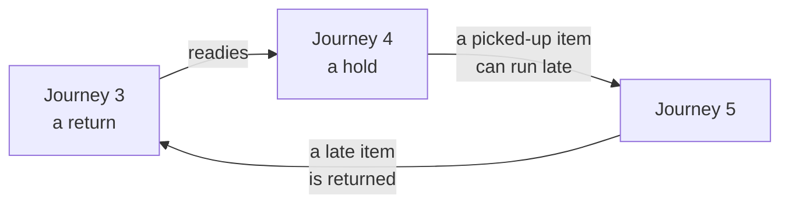

# The DAG rule

Every journey is a directed acyclic graph. This page covers the rule, the reading that makes it checkable, and the three checks choreography must satisfy.

## The rule

The rule is three statements in one:

1. **Every journey is a directed acyclic graph.** A journey never re-enters a step it has already run. A retry, a reminder or a catch-up is not a loop inside the journey. It is a new fact that starts a new run.
2. **Every output one cell yields to another is `Either[Ex, B]`.** The two holes are the failure and the value. A step either produces its value for the next step or an exception that ends the journey at a named failure outcome. Nothing is retried in place.
3. **Choreography is not cyclic.** The cells react to facts, and the reaction chain from any one fact is a DAG.

## The reading that makes it checkable

A first reading of most journey maps finds cycles. The figure draws one in the example, as that reading finds it.

Journey 3 of the example, a return, readies a hold, journey 4. A picked-up item can run late, journey 5. A late item is returned, journey 3. Read as one relation, "this journey references that one", the map cycles.

The rule says that is a defect of the reading, not a fact to accept, and the sharper reading is what the Lean checks.

### Composition and succession are different relations

| Relation | Meaning | In the example | May cycle? |
| --- | --- | --- | --- |
| Composition | A journey runs another journey as one of its steps, in the same run | Picking up a held copy, journey 4's last step, is a checkout as in journey 2. Journeys 1, 2, 4 and 7 open with sign-in, journey 0 | Never. A cycle here is a journey that contains itself |
| Succession | A journey's last fact is the trigger of a new run of another journey | A return, journey 3, readies a hold, journey 4. A checkout's loan runs late, journey 5 | Yes. Each edge is a new fact and a new run. The everyday loop is a succession of DAG runs |
| Pointer | The section sends the reader elsewhere | "Renewing instead is journey 6" | No edge |

Under this reading the rule holds:

- Composition is acyclic, `composition_isAcyclic`, so every cycle passes through a succession edge.
- Succession does cycle, `succession_cycles`.

A journey section must say which of the three each reference is. That is the References table of [the style guide](style-guide.md), section 9. `referencesWithoutKinds_cycle` is the theorem that shows what the map finds when the column is dropped.

### `Either[Ex, B]` is the mechanism that makes a journey a DAG by construction

In Lean the type is `Except Ex B`, a monad in its right hole. A journey is a `do` block of steps `A → Except Ex B`. A `Left` short-circuits to the failure outcome. Fan-out is two steps reading the same value, and fan-in is a step taking both.

Lean accepts only total functions, so a journey written this way cannot loop. A step that re-entered an earlier step would need recursion. Recursion Lean cannot prove terminating is rejected at compile time, with "fail to show termination".

So for journeys written as code, the DAG property needs no check; the compiler is the check. For journeys transcribed from tables, `wellFormed` does the same job: every step waits only on earlier steps.

The two meet in the journey algebra. Every term of the algebra compiles to a graph that satisfies the same rule, `compile_wellFormed`.

### The cell graph is a projection, and its cycles are not journeys

Fines queries circulation, and circulation publishes facts fines reacts to. Drawn as cell-to-cell edges with both kinds in one picture, that is a cycle, `cellGraph_hasCycle`. As journeys, it is two DAGs that both touch the same two cells.

The rule does not require the projection to be acyclic. No reactive system with feedback has an acyclic projection. What the rule does require is in the next section.

## What choreography must satisfy, as checks

There are three rules. Each is a theorem the project's maps carry once the designs supply the data.

1. **Composition between journeys is acyclic.** In the journey map.
2. **Every journey's step graph is acyclic.** By `wellFormed` for transcribed journeys, and by compilation for coded ones. In the journey map.
3. **The event graph between cells is acyclic.** Take only the fact edges, from the cell that publishes to the cell that subscribes. Leave out commands and queries, which are synchronous and return `Either` to the caller.

   If that graph has no cycle, no fact can cause a chain of reactions that returns to its publisher. Choreography is then acyclic in the rule's sense. Commands and queries cannot create a cycle on their own, because they return rather than publish.

   The one way to smuggle a cycle back in is a cell that subscribes to the fact its own command produced. The check for that is "no cell both commands X and subscribes to the fact X publishes as the result". It is decidable from the paths table once each design lists its facts.

If rule 3 fails for some pair of cells when the designs are drafted, that pair is where a design must change. The failing theorem names it.

## What Lean can and cannot do here

The table gives three things a team wants from its documentation, and where the kernel stops.

| Want | Lean can | Lean cannot | What closes the gap |
| --- | --- | --- | --- |
| Understood the same way by any agent and any human | Give a definition one meaning, kernel-checked, so two readers cannot disagree about what it says | Prove the model means what the prose intended, or make Lean readable to someone who does not read it | The prose stays the owner of meaning and cites the model; comments and theorem names in plain words; the generated views as what a reviewer reads |
| Accurate and testable | Check every structural claim by computation, with no proof to write: matrix against journey, zone directions, coverage of every arrow. Prove invariants on executable models | Check accuracy to the world: that people, partners and devices behave as assumed | Assumptions written as assumptions in the model, so the reader sees what is proved and what is taken on faith |
| Lands deep in the code | Be the oracle: an executable model the production code is tested against, and the source the fixtures and views are generated from | Prove the production code correct, unless the code is in Lean | Generation for everything tabular and typed; tests against the fixtures by id; traces replayed into the model; the documents say "proved", "checked", "tested" and "assumed" in those words |
