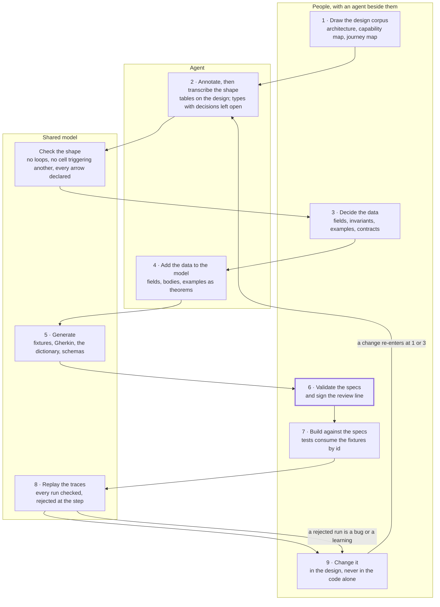

# The lifecycle

How the calculus is used from a design corpus to running code and back. The risk it answers is not that any one journey is hard. It is that several teams, or one team over several months, will make the same design decisions their own way and find out when the journeys meet: how a journey's state is carried, which re-entry choices to offer, what a timeout means as opposed to a refusal, what a retry does and whether it can act twice, what each event is called and who may react to it, which component triggers which and whether anything loops back. Each is easy to decide once. Across many journeys the answers drift, and the first sign is at integration.

The usual controls depend on attention. A template says what a design should contain, not whether two designs agree. A review catches what the reviewer notices, and the number of things to compare grows faster than anyone's time. The lifecycle below puts a shared model, checked by a machine, between the drawing and the code, so that every journey is held to the same rules from the design down to the trace.

## The one rule

The domain types and the examples are authored once, in Lean; everything else is generated from them or replayed into them. Prose owns meaning. Lean owns structure and behaviour. Generated views own nothing. The running system's traces are input to the model, and the model is the judge.

## Nine steps, by who leads each

People own meaning at 1, 3, 6 and 9; an agent transcribes and enriches at 2, 4 and 7; the machine checks and generates at 2, 5 and 8. The thick box is the hard gate.

1. **Draw the design corpus.** People and an agent together, as teams work today: the technology architecture, the capability map, the journey map. The corpus owns what every journey means. Each journey section carries two tables beside its prose, the steps with the cells each names and the earlier steps it waits on, and the references to other journeys each marked composition, succession or pointer; [style-guide.md](style-guide.md) section 9 gives the columns. In the example this is [corpus/](../examples/library/corpus/).
2. **Map, annotate, then transcribe the shape.** An agent draws the journey map and the context map from the corpus and checks them: each journey a DAG, the capability map's matrix row equal to the journey's table, composition acyclic, every arrow between contexts covered by a relationship in the right direction, no path breaking the architecture's direction rule. Then it fills a fixed set of tables on each design: the commands a cell accepts and who may send them, the facts it publishes and subscribes to, the state it keeps, one row per decision, the journey's steps; section 8 of the style guide gives the columns. The tables are the review surface: a person who cannot read the model can read a table, and confirms that the tables say what the design says. The agent transcribes the tables into the model's types, one row to one definition, with the body of each decision left open. The model compiles only if the shape follows the shared rules, and a journey that breaks one is refused with a message naming the rule. In the example this is [JourneyMap.lean](../examples/library/JourneyMap.lean), [ContextMap.lean](../examples/library/ContextMap.lean) and the tables of [designs/circulation.md](../examples/library/designs/circulation.md).
3. **Decide the data.** People and an agent together: the fields of every state and message with their meaning, domain and example value; the invariants; the examples, one per decision row, as Given, When, Then; the contracts a step is held to; the promises a journey makes, each with what it quantifies over. The data dictionary is the acceptance test for the types: a field whose domain admits a value its meaning forbids, an integer that may be null, say, is a wrong type and not a missing comment. All of it goes into the tables, so it is reviewed the same way as step 2.
4. **Add the data to the model.** An agent enriches the types from the tables: the fields, the body of every decision, the invariants as types where they can be and theorems where they cannot, every example as a theorem, the wire shape of every command with its round trip proved. The model compiles again only when no decision is left open, every command survives the trip to the wire and back, the examples reach every command, event and refusal, and a deliberately broken model is noticed by at least one example. In the example this is [Library/](../examples/library/Library/).
5. **Generate.** The machine renders from the model, and nothing here is written by hand: the test fixtures in the wire shape, one per example, serialized by the model's own serializer, and the Given, When, Then of every example as a readable feature file. Every rendering carries the model's hash. In the example this is [generated/](../examples/library/generated/). The schemas, the storage DDL and the diagrams are the same shape of generator and are not built.
6. **Validate the specs.** The hard gate. People read the feature files, the dictionary and the schemas, never the model, and either send comments back to the design or sign. Signing records the review line in the model: the design's path, its content hash and the reviewer. From then on the build fails the day the design changes without a new review.
7. **Build against the specs.** People and an agent write the code. Its tests consume the generated fixtures by example id, replaying each example's history through the code's fold and handing its command to the code's decider, so a failing test names a row of the design. In the example this is [impl/](../examples/library/impl/).
8. **Replay the traces.** Running code records what it did, in test and in production, as a trace in the same wire shape. The machine parses each trace with the same parser, replays it against the model, and rejects a run at the step where it went wrong, naming what the model expected there and what the code reported. This is where the code is validated against the model everywhere it ran, not only where the examples looked.
9. **Change it.** A rejected run, a new requirement or a comment from step 6 re-enters at step 1 or step 3, never in the code alone. A theorem or an example is never deleted: it is superseded or retired with a successor named, an event version is never removed, and the review line is signed again. Everything below the change regenerates.

Validation against the model happens four times, and each catches a different thing. At 2 and 4 the kernel checks the model against the shared rules and against its own examples. At 7 the code is checked against the model's examples. At 8 the running code is checked against the model everywhere it ran. At 6 a person checks the model against the design, which no kernel can do, and signs for it.

## The round trip, as artifacts

The same lifecycle as six stages, each with the artifact it produces, the direction of generation and the acceptance test.

| Stage | Input | Artifact | Direction | Acceptance test |
| --- | --- | --- | --- | --- |
| 1. The cell's I/O | The journey map and the context map | Per cell: commands in and from whom, facts subscribed and from whom, facts published, queries offered, partner calls; the paths table; the relationship on each arrow | Maps → paths → the type parameters of each `Cell` | Every arrow on either map is a paths row and a parameter of some cell |
| 2. The type-level model | Stage 1, and each design's tables | A module per cell with its five types and the bodies as `sorry`; the journeys as terms | Tables → Lean | Compiles; every structural theorem holds |
| 3. The data model | Stage 2, and the data | State and event types, invariants as types or theorems, the bodies written; the dictionary as doc comments; `parse` and `serialize` per gateway | Lean → wire schemas | Zero sorries; `parse (serialize c) = .ok c` for every command; every loss is a parse refusal |
| 4. Specification by example | Stage 3 | Examples as values, each a theorem; fixtures in the wire shape; feature files | Lean → fixtures and features | Every example holds; coverage over commands, events and refusals; a surviving mutant is a failing test |
| 5. The code | Stage 4 | The implementation, its tests consuming the fixtures by id | Fixtures → tests | Every example passes against the implementation |
| 6. The traces | The running tests, then production | Traces in the wire shape, parsed by the same `parse`, replayed by `Cell.conforms` | Traces → Lean | Every test trace conforms; a rejected trace names the step |

The cycle closes at stage 6: a trace the model rejects is either a bug in the code or a learning for the design, and the next change is to the design and then the model, which regenerates everything below it.

## Where the two sources meet

**Prose and Lean.** The journeys in the vision and each design's purpose and rules are authored prose and own meaning. The Lean owns the structure and behaviour the prose describes. The review that says the second captures the first is human, and it is recorded: a line in the project's header with the design's path and content hash at review time, and the reviewer. The build fails when the design's hash changes and the line does not. Drift cannot be prevented between prose and model; it can be made visible the day it happens.

**Lean and the wire.** One `parse` and `serialize` pair per gateway, written once and used four ways: by the production gateway, by fixture emission, by trace ingestion and by the round-trip theorem. The model and the tests no longer share a description of the data; they share the bytes. The context map's relationships become the parse's properties: a conformist's parse is the identity up to shape, an anti-corruption layer's is a real translation and the only place a refusal means "not understood" rather than "no".

| Use | Direction | Who runs it |
| --- | --- | --- |
| The production gateway | wire → model | The implementation |
| Fixture emission | model → wire | `lake exe fixtures`, over every Given, When and Then |
| Trace ingestion | wire → model | `lake exe replay`, over test and production traces |
| The round-trip theorem | both | The kernel, once, for every command |

## What a non-technical reader reviews

Two kinds of artifact and nothing in between. Authored prose that owns meaning: the journeys and each design's purpose and rules, edited by people. Generated views that own nothing: rendered from the Lean, stamped with the model's hash, never edited by hand. Reviewers read the prose and the views. Their comments change the design; the design changes the Lean; the views regenerate. A view without a stamp is not a view.

| View | Rendered from | Why this form |
| --- | --- | --- |
| Feature files | The examples | Given, When, Then in plain sentences is the format reviewers already read, and the same examples drive the code's tests. The thing reviewed is the thing executed |
| The data dictionary | The types and their doc comments | Field, type, meaning, example value. The missing-docs linter makes "every field has a sentence" a build failure |
| Event Modeling diagrams | The journey DAGs | Swimlanes per cell, commands, events and views in time order: the industry's picture of this calculus. Not built |

## What the checks catch

A journey a user can leave part-way and resume on another channel is the test case, because every team gets it differently. The rule is one line: re-entry is a decision made on the journey's recorded state, never a loop back into the journey.

- **Resume wired as a loop.** If "continue" is wired as a jump back to an earlier step inside the journey, the journey has a cycle and the model refuses it. Resuming is a new run that starts from the recorded state. New runs can repeat as often as the user returns; a single run never loops.
- **A choice with no example.** A re-entry choice the examples never reach fails the coverage check.
- **Channels that disagree.** The channel is an input to the decision, not a separate design. If the app offers a choice the web does not, either a row says so, or the app's trace is rejected at the step where it differs.
- **Questions answered once.** One row per branch forces "what if the user resumes on two channels at once?" to be answered in the design, once, instead of in each team's code.
- **The wrong person resuming.** Who is acting rides on the command, so "a helper may view but not resume" is one row in the table and one refusal, checked before the cell looks at the journey's state.
- **A trace that does not hang together.** If the record shows a step reacting to a fact recorded after it, or to one from a different run, the run is rejected on its shape alone, before any step is replayed.

## The guarantees

Each holds for every journey any team writes, not only the ones someone tested, and each rules out a specific cross-team failure.

| Guarantee | How it holds | The failure it rules out |
| --- | --- | --- |
| Every journey built from the shared steps has no loops | Proved, for every journey term; checked, for every transcribed journey | A loop or a retry-in-place others cannot reason about |
| No cell can trigger another cell's command directly | By construction: the wiring cannot be written | Hidden orchestration, wired differently by each team |
| Every command, event and refusal has at least one example | Checked, every time the model compiles | Branches nobody specified, and so nobody tested |
| Every command survives the trip to the wire and back | Proved, for every command | Two teams hand-writing different shapes for the same message |
| A repeated command with the same key acts once | Proved per cell | Each team inventing its own retry behaviour |
| A cell waiting on two facts acts the same whichever arrives first | Proved per cell | Joins that pass in testing and fail when production reorders messages |
| A cell's state from its full history equals its state from a snapshot plus what came after | Proved, for every cell | Resumed journeys that disagree with their own history |
| Every message carries the same typed envelope, and a cell cannot read a field the envelope does not name | By construction: the read cannot be written | Each team adding its own headers |
| Who may issue which command is checked before the cell decides, and an allowed sender gets exactly the cell's own decision | Proved, for every cell and every policy | Each team wiring its own authorization, in a different place |
| What a cell publishes in answer to a command is a well-formed run | Proved, for every command and cell | Events that cannot be traced to what caused them |
| What the code did is a run the model allows, and a run's facts cite only earlier facts in the same run | Checked, per trace | Code that quietly drifted from the design; joins wired to the wrong run |
| A decision reads only the answers and the clock reading handed to it, and records the version of the answer it was made on | By construction for the call; proved per cell for the version | Decisions made on stale data that nobody can trace |
| What crosses a boundary keeps its run, and comes back exactly | Proved, for every mapping and every message | Journeys that cannot be followed across a boundary |
| An automated decision becomes a command in one place, through a policy whose every branch names its rung, and a retried hand-off is the same command | Proved, for every proposal and every state | Each team wiring its own automation |
| A promise about timing or count is a check over runs, with the run that broke it named | Checked, per run; loosening a limit never breaks a kept promise, proved | Service promises held by attention |
| A theorem or an example is never deleted, only superseded by name, and retiring an example without a successor fails coverage | By the build | A proof in the way quietly edited to pass |
| A journey's latency, availability budget and cost follow from its steps' contracts, and tightening a step never worsens a journey's bound | Proved, for every journey and every set of contracts | End-to-end numbers nobody can derive |
| Every quality attribute says what it ranges over before an example is written | By construction: an attribute cannot be written without its scope | Service levels stated as single examples that cannot check them |
| Who may do what is a set of permits and forbids where a forbid always wins, a permit is always required, and order and duplicates never matter | Proved, for every rule set | Authorization that behaves differently when rules are reordered |

Specification by example is how people agree. Lean is how we know they agreed on the same thing.

## What it does not do

- **It does not prove the design means what people intended.** Whether the model captures the design is a human review, recorded in the model with the design's hash, and the build fails when the design changes without a new review.
- **It does not prove the code.** The code is tested against the model through the generated examples and the replayed traces. Where a cell is pure logic, the model itself can be compiled and called as the production code, which closes the gap for that cell.
- **Transcription can vary.** An agent turns tables into Lean, and two runs could differ. The fixed tables limit that, and the model refuses anything off-shape.
- **It needs each cell to keep its history**, as events or as versioned rows. A cell that keeps neither is one the model cannot describe.
- **Some generators are not built.** Fixtures, feature files, the review check, the mutation gate and the trace checker run. The generators for message schemas, storage DDL and diagrams, and random inputs with the model as the oracle, are the next pieces.

## Alternatives considered

| Alternative | What it gives | Where it falls short |
| --- | --- | --- |
| Design reviews and shared templates | A shared vocabulary, and a reviewer who sees the whole | Holds only what a reviewer notices; the comparisons grow faster than review time |
| Specification by example alone | Readable, testable examples per journey | Each team's examples are its own; nothing says two teams covered the same decisions |
| Contract tests between services | Each pair of services agrees on its messages | Checks the boundaries, not a journey's shape, state or re-entry rules; a complement, not a substitute |
| A workflow engine as the shared design | Executable flows and a visible diagram | Allows loops, and a flow is checked by running it rather than before; fits inside one cell, not as the design across teams |
| A formal model without examples | Strong guarantees | Unreadable to most of the people who must agree on it, and nothing ties it to the code |
| **This method** | Examples people read, a model a machine checks, code tested against both, traces replayed into the model | Needs the annotation discipline and a CI build; the review that the model matches the design stays human |
