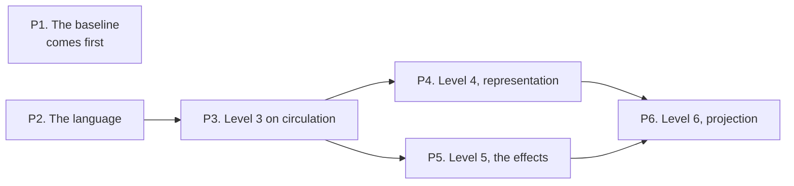

# Into the code: how far below the cell the model can go

A problem statement · Nov 1, 2026 · revised by dated notes beside it, never rewritten

> The method today holds the code to the design at the cell's boundary and stops there. Every decision the model takes is a decision the code no longer takes. We ask how many decisions the model can take, level by level below the boundary, before the cost of taking them outruns what it removes. We propose to measure the answer on the implementation rather than on the model.

## The problem

A cell's model states what `decide`, `react` and `evolve` return. It says nothing about how the code gets there. The link from model to code is observational, three ways:

- The examples: one generated fixture per design row, which the code's tests consume by id.
- The traces: what the code did, replayed into the model and accepted or rejected by name.
- Mutation: deliberate changes to the model that the examples and theorems must notice.

The white paper names the gap this leaves in [section 7](../white-paper.md#7-where-it-can-fail-and-what-we-propose):

- refinement is not proved, because it needs the code in a form the kernel can reason about (item 1);
- thirteen examples prove thirteen points (item 2);
- and the model-to-code link is testing, with the compiled pure core and refinement proofs proposed but not built (item 3).

Around the three functions sits the code the white paper calls the shell ([section 4.11](../white-paper.md#411-inputs-never-calls)). It reads storage, the clock and other cells' answers before `decide`, and it stores and publishes what the cell emits after it.

Below the boundary, in the three functions and in the shell alike, every decision is made at the keyboard. Whoever is typing decides each of the following, one at a time, with convention as the only hold:

- which guard comes first;
- what a counter is compared against;
- whether two commands arriving together for one instance of a cell need protection, and of what kind;
- what an effect must guarantee about storage or the clock for the cell's theorems to hold.

Engineers already answer these questions at a whiteboard before they implement, in pseudo-code. The pseudo-code is thrown away. The decisions it recorded are re-made in the code and in the reviewer's head.

## Why this is important

**The value is noise removed from codification, not depth for its own sake.** Verification stays critical, and it is not the value statement. When the model has taken the branch structure, the guards, the constants, the invariants and the obligations, what is left for the engineer or the agent is a boxed job. That job is to fill in the shell against tests that already say what every line must do. The subjective part of implementation is where two competent people write two different programs from one design and a reviewer must decide between them. It shrinks to the part the model chose not to decide.

**The reader of the tests has changed.** A deeper model leaves the implementer less room, and for a person that room has a value the method must weigh against what it removes. When the implementer is an agent, a tightly boxed job is the point: the agent's freedom is exactly the place its errors live. A method that moves decisions left, into a model that is reviewed against the design and held by the kernel, is a method that leaves an agent less to get wrong.

**It is the next test the method's own argument asks for.** Section 7 proposes the compiled pure core and random inputs with the model as oracle. Both need the model in a form with structure to walk. A Lean function has none: it can be run and proved about, not inspected. The same lack is why the example's ten mutants are hand-written edits to its Lean files. It is also why nobody can ask the model which design rows a production trace reached. One change answers all of these at once: a model written as data that the kernel reads.

## The hypothesis

A code-shaped model, the **program model**, can sit between the cell's three functions and the code: a small total language, deep-embedded in Lean as data, with `let`, `match`, guards and folds over finite collections and no general loop or recursion, which is the rule a journey already keeps. Lean proves the program model refines the cell, emits tests from its structure that the hand-chosen examples cannot, and holds the code to it below the boundary.

The rule the tower adds is modeled on the white paper's treatment of the wire:

- *every level below the cell refines the one above with its abstraction function stated;*
- *the code is a projection of the lowest level;*
- *and what the projection loses is a list*.

We call that list the assumption list. It is the fourth of the README's four words made a document: what is assumed is named, entry by entry, where the build can see it.

The one objective: at each level, which code decisions does the model take, which does it fence, and which does it leave. The count of what it leaves is the answer.

### The tower

Levels 0 to 2 exist today. Below level 2 the tower has two axes, representation and effects. They share level 2 as their top and level 6 as their bottom, with the runtime under both. An experiment names which axis it walks first.

| Level | What is modeled | Axis | Link to the level above | Verb |
| --- | --- | --- | --- | --- |
| 0. The maps | Journeys as DAGs, the context map | Top | None | Checked |
| 1. The signature | The five types, the codec | Top | Round-trip law per command | Proved |
| 2. The behavior | `decide`, `react`, `evolve` as Lean functions; the examples | Both axes start | Each example holds; coverage by kind | Checked, proved |
| 3. The branches | Each Decide and React row as a named guarded branch of the program model | Both | Its interpreter equals level 2 on every input | Proved |
| 4. The representation | The state the code keeps: maps, counters, indices | Representation | An abstraction function; `evolve` commutes with it | Proved |
| 5. The effects | Storage, the outbox, the keys already seen, the clock and queries as the effects each command declares; the shell implements them | Effects | Level 2's theorems kept, given each effect's guarantee | Proved given each effect's guarantee; the guarantees tested by a suite every implementation of an effect must pass; the rest named on the assumption list |
| 6. The statements | Function bodies in the program model | Both axes end | Refines 4 and 5; the pure core projected from it | Proved to 5; the core projected |
| 7. The runtime | Threads, scheduling, memory, the target language's own semantics | Under both | None | Assumed; traces tested |

Numbers in the program model are exact. Proofs over machine floating point are impractical, so the conversion to the target's number type is an entry on the assumption list. The entry names the boundary cases where exact and machine arithmetic disagree. A threshold compared exactly in the model and in machine arithmetic in the code is the one place the two can disagree while each looks right on its own.

### Three kinds of code decision

The question "do we need a lock here?" sorts every code decision into one of three kinds. The method's job per level is to move decisions from the third kind to the second, and from the second to the first, and to say which stayed.

| Kind | Examples | What pins it | Level | Freedom left |
| --- | --- | --- | --- | --- |
| The model makes it | Branch structure, guards, constants, which row fires, the fold's order | Path and boundary examples from the syntax | 3 | None behavioral; the code may restructure |
| The model fences it | Representation, effect order, concurrency, retry | An invariant the model states and a test that attacks it | 4, 5 | Any mechanism that keeps the invariant |
| The model cannot see it | Allocation, logging, latency, batching | Nothing; the assumption list names it | 7 | All |

The lock is the second kind. Two commands arrive at once for the same stream. A stream is the ordered history of one cell instance. The model states what must hold afterwards, and a generated test runs the two together and checks it. The code must have some mechanism, and which one is free: a lock, a compare-and-swap on the stream's version, a single-writer actor, a unique constraint in the store. The model does not pick the mechanism and should not. A mechanism pinned where only an invariant is needed makes the model a worse program than the code could be. A test that pins the order of the shell's effects fails every implementation that keeps the invariant another way.

Freedom here is behavioral. Tests pin what the code does, never how it is written. Only projected code has no structural freedom either.

## What would count as evidence

**The measure is residual freedom**: the behavioral freedom an implementation has left after the generated tests, measured on the implementation and not on the model.

The implementation is held constant and mutated with one fixed operator set (swap a comparison, negate a guard, shift a constant, drop a branch). Only the test suite varies from level to level. A mutant the suite kills is a decision the tests took, and one that survives is a decision they left.

The share that survives each level's suite, and the list of what each survivor stands for, sorted into the three kinds, is the number per level. At level 6 the core is projected and has no freedom by construction, so the measure is taken on the shell alone.

Mutants generated from the program model's own syntax are a different instrument and never the measure. A boundary test and a constant-shifted mutant drawn from the same syntax kill each other by construction. So a share built from them would report the generator's self-consistency. Their use is as a gate on the generator: every syntax mutant must be killed by the generated tests, and one that survives is a hole in the generator.

| Column | What it holds | Where it comes from |
| --- | --- | --- |
| Cost | Proof lines; proofs that needed invention beyond `simp`, `cases` and induction | The build, per level |
| Value | Implementation mutants killed by this level's suite and not by the one above | The gate, per level |
| Residual | Implementation mutants that survive, each named by the decision it stands for and sorted into the three kinds | The gate's survivors |
| Projected | Lines of the implementation derived from the model rather than written | The generator, at level 6 |

A level pays when the value column moves and the cost column does not run away. The level where it stops paying is the paper's answer. Reaching it is the expected result, not a failure.

**What would count against the hypothesis.**

- residual freedom that does not fall from level 2 to level 3 on the example's circulation cell, where every Decide row is a guard on a count;
- a level-3 equivalence proof that needs invention rather than `cases` and `simp`, since the branches are a transcription of the rows;
- or a generator whose own syntax mutants survive its tests.

Any of the three on the first experiment ends the direction with a note that says so.

Two rules on reading the measure. A mutant that preserves behavior is equivalent and not a surviving decision. The filter is a search over inputs for one that distinguishes it from the model, exhaustive up to a stated bound and a property test beyond it, with the bound reported. And a survivor is not always a defect in the tests: a second-kind survivor names freedom the method means to keep. The sorted list is the result; the share alone is not.

## How we might explore this with proofs of concept

Each proof of concept answers one question and needs what its row says. It reports in the measure's columns and has a condition on which it stops. The first needs no Lean at all and gives the baseline every later number is compared against, so it comes first.

In the figure, an arrow runs from a proof of concept to each one whose Needs column names it.

| | Proof of concept | The question it answers | Needs | Reports | Stops when |
| --- | --- | --- | --- | --- | --- |
| P1 | **The baseline.** A mutation runner over the example's implementation with the fixed operator set, run against the thirteen generated examples as they are | What is the residual freedom of the code today, at level 2 | The example's implementation and fixtures, unchanged; a runner that applies each operator and runs the suite | The survivors at level 2, named and sorted into the three kinds | The list is written; no stop condition, this is the baseline |
| P2 | **The language.** The program model's syntax and semantics as Lean data, with its totality and a trivial equivalence proved | Can a small total language be deep-embedded cheaply enough to pay | A package requiring the calculus by path | Lines of syntax, semantics and proof; what totality cost | The language cannot express a Decide row of the example without a loop |
| P3 | **Level 3 on circulation.** The cell's Decide and React rows as guarded branches, transcribed from the design and not from the level-2 Lean, by a different author; the interpreter proved equal to level 2 on every input; path examples, boundary examples and syntax mutants emitted from the syntax in the same wire shape the example's tests already consume | Does the generator catch what the thirteen examples miss, and what does equivalence cost | P2; the example's model and fixtures generator by path | The generator gate; then the measure against the level-3 suite beside P1's baseline | Residual freedom does not fall, or the equivalence proof needs invention |
| P4 | **Level 4, representation.** An abstraction function from the implementation's state to the model's, `evolve` commuting with it, and representation checks emitted into the implementation's tests | Does fencing the representation remove decisions the branches did not | P3 | The measure against the level-4 suite; the proofs that needed invention, counted | The abstraction function needs an invariant the design does not state |
| P5 | **Level 5, the effects.** The effects each command declares; write sets derived from them; race examples as per-stream serializability, the model computing both serial outcomes and the test accepting either; the obligation list, one named theorem per declared effect, abstraction function and racing pair, each proved or carried on the assumption list by name | Can the model answer "do we need protection here" and "what must each effect guarantee" from its own structure | P3; a test suite every implementation of an effect must pass; a shell around the example's implementation, which today has none | The measure on the shell; obligations proved against obligations assumed | The race examples pass for a mechanism the design would reject, which means the invariant is too weak |
| P6 | **Level 6, projection.** Function bodies in the program model; the pure core projected to the target and called by the shell | What share of the implementation is derived rather than written, and what is left in the shell | P4 and P5 | The projected share; the measure on the shell alone | The projected core cannot be called without a decision the model did not make |

Two outputs of P5 are new to the method:

- **Race examples** come from the effect declarations rather than from anyone's intuition about concurrency. Any two commands whose derived write sets overlap on one stream are a racing pair, listed whether or not a person would have thought to test it.
- **The obligation list** is verification conditions at the architecture level rather than the statement level. A program verifier generates its conditions from a function's body, and this generates them from the shape of the tower.

When a syntax mutant survives the generated tests, a search over the input types for a value where the mutant and the model disagree yields a concrete case nobody wrote, and that case is proposed to the design's owner as a new example. That is the loop section 7 proposes, random inputs that kill a mutant becoming examples. The deep embedding is what makes it mechanical.

## What is already known

Three things are known before any proof of concept runs. Each shapes the plan.

- **Levels 0 to 2 are built.** The example carries them, with every number in the white paper's evidence section taken from its build.
- **The gate today mutates the model, not the code.** The example's ten mutants, in its `mutants.json`, are hand-written edits to its Lean files. Each is killed by an example or a theorem. Nothing in the repository mutates the implementation, so the measure this statement proposes has no baseline yet. P1 builds it, and that is why it comes first.
- **The example's implementation is a pure fold and a decider and nothing else.** Its state is the model's three fields as a dictionary. Its own header says storage and transport would wrap it and never reach inside. So P4 needs nothing the example lacks, and P5 needs a shell that does not exist yet. The open question on the axis leans on that.

## What this is not

- **Not a change to the calculus or the example.** Nothing in `cell-calculus/` or `examples/library/` moves until a shape proved here graduates by supersession. Every proof of concept lives in a package under this directory that requires the two by path.
- **Not a skill.** The lifecycle's skills are procedures held to the example as their golden answer and changed with their evaluations. A skill for levels 3 to 6 follows once a procedure exists to hold it to. Writing one now would encode a prediction.
- **Not a code generator for production.** Projection at level 6 is the last proof of concept. It is a measurement of what can be derived, not a tool to ship.
- **Not a proof that the code is correct.** The method proves the model and holds the code to it. Below the cell it holds more of the code, to more of the model; the runtime, the effects' guarantees and the world stay assumed, by name.

## The friction we expect

Each is in the shape of section 7: where it rubs, and what guards it.

1. **Lean cannot read the target language.** Guard: project one language first, test the rest, lift only where a verifier for that language already exists.
2. **The semantics differ.** Unbounded naturals against machine integers; string equality, map order and exceptions. Guard: exact numbers in the program model and machine types on the assumption list per target, each entry naming its boundary cases.
3. **The abstraction function is a blind spot.** Whatever a projection forgets, no proof above it can see. A function that sends two implementation states to one model state hides every difference the code makes between them. A check that imposes an order the code never produced hides whether the code orders anything at all. Guard: every entry on the assumption list says what it hides, and the gate carries one implementation mutant per entry that the tests are expected to miss, recorded as a known survivor.
4. **The program model becomes a second implementation that drifts.** Guard: governed as the model is, a review line with its hash, supersession, never edited to pass; at level 6 projection removes the drift for the core.
5. **Level 3 proves the transcription, not the design.** Guard: the branches are transcribed from the design's rows by a different author or agent than wrote level 2.
6. **Self-agreement.** One author can write design, model and code so that all three agree and are wrong. Guard: the gate in CI from the first commit; traces after; a second transcription of the same design.
7. **Pinning a mechanism where an invariant suffices.** Guard: every second-kind test attacks an invariant, and each race example carries one review question: does this pass for every correct mechanism?
8. **Cost outruns value at some level.** This is the expected result. The measure says where; the paper stops there and writes the level down.
9. **The measure is read as a score to maximize.** Guard: the sorted list of survivors is the result; the share alone is not.
10. **The calculus has no dependencies.** A property-testing library or a generator breaks that. Guard: they live in this directory's packages, which may take what the calculus does not, and only a shape proved here graduates.

## Open questions

Each has a leaning. These are the owner's decisions, recorded so that a reader knows which were taken.

- [ ] **Which axis after level 3.** Representation (P4) or effects (P5) first. Leaning: representation, because P4 needs nothing the example lacks and P5 needs a shell the example does not have.
- [ ] **How deep to aim.** Level 5 as the goal and 6 as the stretch, or 6 as the goal. Leaning: 5, with 6 as the measurement of what projection leaves.
- [ ] **Dependencies in this directory.** May a package here take a property-testing library or a code generator. Leaning: yes, quarantined here; the calculus's own rule is unchanged.
- [ ] **CI.** Does a package here build in CI from its first commit, or once its first proof of concept is green. Leaning: from the first commit, with a non-empty mutants file, because a test proves nothing until it has been seen to fail.
- [ ] **The paper's title.** The house style wants a claim, and the claim is the level where cost outruns value. Leaning: the title waits for P3's number.

## Terms

| Term | Meaning here |
| --- | --- |
| The program model | The small total language, deep-embedded in Lean as data, in which the levels below the cell are written |
| The shell | The white paper's word for the code around a cell's three functions: it reads storage, the clock and other cells' answers before `decide`, and stores and publishes what the cell emits after it |
| An effect | An interface the cell's core declares and calls, and the shell implements: a read or write of storage, a publish through the outbox, a clock reading, a query of another cell; at level 5 each command declares its effects, and each effect carries a guarantee the cell's theorems need from it |
| An effect's guarantee | What every implementation of an effect must do for the cell's theorems to hold, tested by a suite each implementation must pass. Not a contract in the white paper's sense, which is a journey step's assumption and guarantee per viewpoint |
| The assumption list | The named list of what the model assumes rather than proves: the effects' guarantees, the runtime, number conversions; every entry says what it hides |
| A stream | The ordered history of events for one instance of a cell; two commands on the same stream can race |
| Residual freedom | The behavioral freedom an implementation has left after the generated tests, measured by mutating the implementation under a fixed operator set |
| The generator gate | The syntax mutants of the program model, every one of which the generated tests must kill; a hole in the generator, never the measure |
